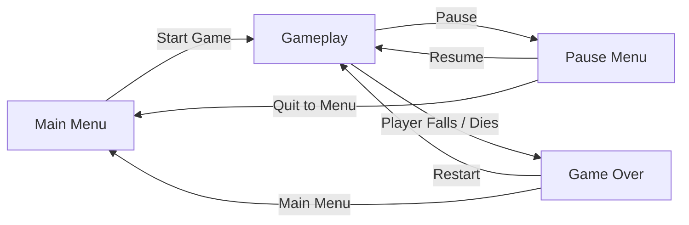
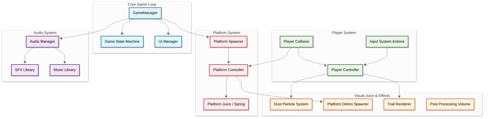
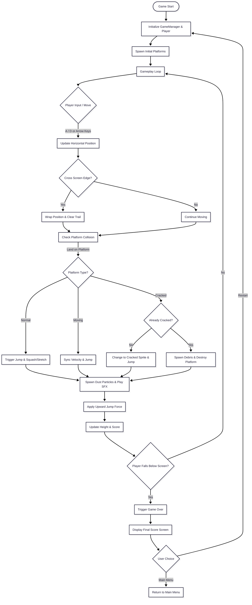

## Developer and Contributions
**nataalyly** (Game Designer & Programmer)

## About
Lompat Anjay is a casual vertical arcade game that challenges players to jump as high as possible across various dynamic platforms. Manage your jump momentum, avoid obstacles, utilize special platforms like moving and cracked platforms, and achieve the highest score. Every jump requires precise timing and strategy, as a single mistake will cause you to fall!

## Key Features
**Platform Mechanics**: Jump automatically on top of various platform types. Experience bouncy platforms, moving platforms that travel left and right, and cracked platforms that shatter into pieces when stepped on.

**Screen Wrap & Movement**: Utilize the screen wrap feature, where players moving past the left or right edge of the screen smoothly reappear on the opposite side without disrupting gameplay momentum.

**Juicy Visuals & Juice Effects**: Enjoy a satisfying gameplay experience enhanced by visual effects such as Squash & Stretch when jumping, dust particle effects at the character's feet, a Trail Renderer for movement, and Post-Processing touches (Bloom & Vignette).

<br>

## Gameplay
Select your character, then jump from platform to platform as high as you can.
Platforms spawn automatically — just keep moving and don't fall.

<table>
  <tr>
    <td>
      
    </td>
    <td valign="top">

**Platform:** WebGL (Browser) <br>
**Engine:** Unity <br>
**Language:** C# <br>

<br>

[](https://nataalyly.itch.io/lompat-anjay)
[](https://github.com/nataalyly/Lompat-Anjay)

  </td>
  </tr>
</table>

---

## Scene Flow


## Layer / Module Design


## Modules and Features
| 📂 Name | 🎬 Scene | 📋 Responsibility |
|---------|----------|-------------------|
| **Core Game System** | **Gameplay** | - Control game states (Playing, Paused, GameOver)<br/>- Manage scoring system based on player's max height<br/>- Handle UI transition logic and Game Over panel<br/>- Save and track high scores |
| **Player System** | **Gameplay** | - Control horizontal movement using Unity Input System<br/>- Handle automatic jump logic upon touching platforms<br/>- Manage Screen Wrap feature (teleporting across screen edges)<br/>- Trigger Squash & Stretch effects during jumps |
| **Platform System** | **Gameplay** | - Procedurally spawn platforms as the player ascends<br/>- Manage platform types (Normal, Moving, and Cracked)<br/>- Handle platform destruction logic after being stepped on twice<br/>- Apply spring/bouncy animation effects to platforms |
| **Visual Juice & Effects** | **Gameplay** | - Spawn dust particles at the player's feet upon jumping<br/>- Enable Trail Renderer with automatic clearance during screen wraps<br/>- Spawn rigid body debris pieces when cracked platforms break<br/>- Configure Post-Processing (Bloom, Vignette, Color Adjustments) for visual aesthetics |
| **UI Management** | **Gameplay** | - Update score display in real-time on screen<br/>- Manage menu buttons with Juicy Button effects (scale up/down on click)<br/>- Display Pause and Game Over panels |
| **Audio System** | **Persistant** | - Manage background music and sound effects (jump, game over, button click)<br/>- Handle independent volume controls (SFX & BGM)<br/>- Persist across scene loads using DontDestroyOnLoad |

<br>

## Game Flow Chart


<br>

## Event Signal Diagram
```mermaid
classDiagram
    %% --- Core Management ---
    class GameManager {
        +OnGameStart()
        +OnGameOver()
        +OnScoreUpdated(score: int)
        +AddScore(amount: int)
    }

    class UIManager {
        +OnScoreChanged(newScore: int)
        +OnGameOverPanelToggle(active: bool)
    }

    %% --- Player System ---
    class PlayerController {
        +OnMove(value: InputValue)
        +Jump()
        +TriggerBounceEffect()
        +Die()
    }

    class PlayerCollision {
        +OnCollisionEnter2D(col: Collision2D)
        +OnCollisionExit2D(col: Collision2D)
    }

    %% --- Platform System ---
    class PlatformController {
        +platformType: PlatformType
        +OnPlayerLand()
        +HandleMoving()
    }

    class PlatformJuice {
        +TriggerPlatformBounce()
    }

    class PlatformSpawner {
        +SpawnPlatform()
        +RecyclePlatform()
    }

    %% --- Audio System ---
    class AudioManager {
        +PlayJump()
        +PlayPlatformBreak()
        +PlayGameOver()
    }

    %% --- Relations ---
    GameManager --> UIManager : updates
    GameManager --> PlayerController : monitors state
    PlayerCollision --> PlayerController : triggers actions
    PlayerCollision --> PlatformController : detects landing
    PlatformController --> PlatformJuice : triggers spring effect
    PlatformSpawner --> PlatformController : instantiates
    
    PlayerController --> AudioManager : requests jump sound
    PlatformController --> AudioManager : requests break sound
    PlayerController --> GameManager : reports game over
  ```

<br>

## Controls
| Input | Action |
|---|---|
| `A` / `D` or `←` / `→` | Move Left and Right |
| `Left Click` (UI) | Interact with menu buttons (Juicy Button) |
| `Esc` / `Pause Key` | Open the Pause Menu |

## Progression System
- **Scoring**: Score increases automatically based on the maximum vertical height (highest Y position) reached by the player.
- **Difficulty Scaling**: As the player's score increases, the spawn frequency of special platforms (such as moving and cracked platforms) becomes more dynamic.
- **End Condition**: The game ends when the player character falls past the bottom boundary of the camera (game over zone).

## Development Duration
~2 weeks — solo, from initial setup to WebGL deployment on itch.io

## Notes
- Best played on desktop via Google Chrome or Microsoft Edge.
- Found a bug? Feel free to open an issue.

## Credits
Made by [Natnat](https://github.com/nataalyly)<br/>
Free assets from [Kenney](https://kenney.nl); no original art created
